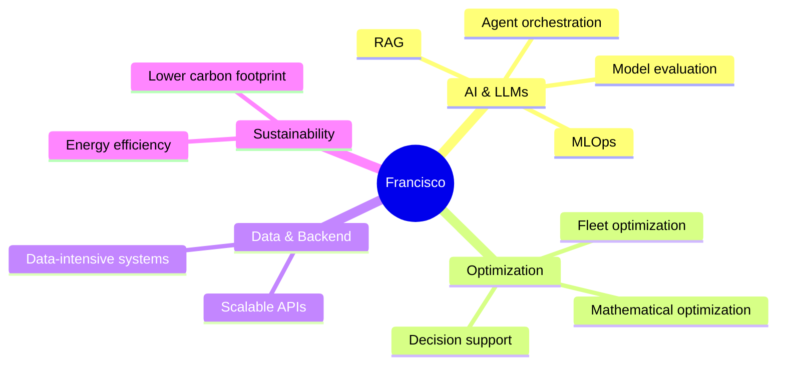

# Hi, I'm Francisco Vicente Suárez Bellón 👋

### Senior AI Engineer | Multi-Agent Systems · LLMs · RAG · Optimization

I design and build production-ready AI systems, with a focus on **multi-agent applications**. I’m particularly interested in how specialized agents can collaborate to break down complex tasks, use tools and data, and coordinate multi-step workflows. My work and interests also include LLM orchestration, RAG, evaluation, and the engineering practices needed to make these systems reliable in production. I enjoy applying machine learning and mathematical optimization to real-world challenges, especially in energy and fleet operations.

## Interests

- 🤖 LLM applications, agent orchestration, and retrieval-augmented generation (RAG)
- 📊 Machine learning, model evaluation, and MLOps
- ⚡ Mathematical optimization and decision support
- 🌱 Energy efficiency, sustainability, and fleet optimization
- 🏗️ Scalable backend systems and data-intensive applications

## Technologies

### Languages

### AI, LLMs & data

### Backend, databases & infrastructure

### Frontend

## Areas of Interest

## Education

- **BSc in Computer Science** — University of Havana
- **Architecture and Development of Applications with LLMs** — University of Havana
- **Introduction to Data Science** — Complutense University of Madrid

## Connect

